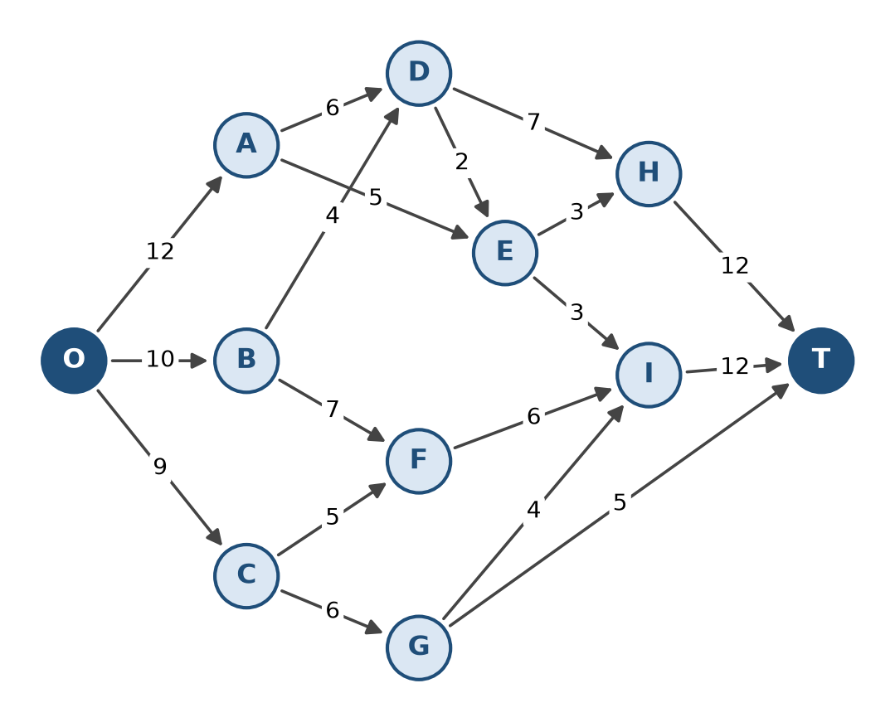

# 1. Modelación matemática de la red

La empresa transporta paquetes desde un centro de origen hasta un centro de destino a través de
una red de centros logísticos intermedios. Cada ruta permite circular en un solo sentido y tiene un
límite de paquetes por hora. Este problema se modela como una **red de flujo**: un grafo dirigido
$G = (V, E)$, una función de capacidad $c$ sobre sus arcos y dos vértices distinguidos, el origen
$s$ y el destino $t$.

La configuración inicial está guardada en `data/red_inicial.json` y es la que carga la aplicación
al iniciar.

## 1.1 Conjunto de vértices

Cada vértice representa un centro logístico:

$$
V = \{O,\ A,\ B,\ C,\ D,\ E,\ F,\ G,\ H,\ I,\ T\}, \qquad |V| = 11.
$$

Se cumple el intervalo exigido para la configuración inicial: $10 \le |V| = 11 \le 12$.

## 1.2 Conjunto de arcos

Cada arco $(u, v) \in E$ representa una ruta de transporte que lleva paquetes **desde** el centro
$u$ **hacia** el centro $v$. El arco no autoriza el traslado en sentido contrario.

$$
\begin{aligned}
E = \{\ & (O,A),\ (O,B),\ (O,C),\ (A,D),\ (A,E),\ (B,D),\ (B,F),\ (C,F),\ (C,G), \\
        & (D,H),\ (D,E),\ (E,H),\ (E,I),\ (F,I),\ (G,I),\ (G,T),\ (H,T),\ (I,T)\ \}
\end{aligned}
\qquad |E| = 18.
$$

Se cumple el intervalo exigido: $15 \le |E| = 18 \le 20$.

## 1.3 Función de capacidad

La función $c : E \to \{1, 2, \dots, 12\}$ asigna a cada ruta su capacidad máxima de traslado, en
paquetes por hora.

| N° | Arco $(u, v)$ | $c(u, v)$ | Tramo de la red |
|---:|:---:|:---:|:---|
| 1 | $(O, A)$ | 12 | Origen → clasificación |
| 2 | $(O, B)$ | 10 | Origen → clasificación |
| 3 | $(O, C)$ | 9 | Origen → clasificación |
| 4 | $(A, D)$ | 6 | Clasificación → transferencia |
| 5 | $(A, E)$ | 5 | Clasificación → transferencia |
| 6 | $(B, D)$ | 4 | Clasificación → transferencia |
| 7 | $(B, F)$ | 7 | Clasificación → transferencia |
| 8 | $(C, F)$ | 5 | Clasificación → transferencia |
| 9 | $(C, G)$ | 6 | Clasificación → transferencia |
| 10 | $(D, H)$ | 7 | Transferencia → consolidación |
| 11 | $(D, E)$ | 2 | Entre centros de transferencia |
| 12 | $(E, H)$ | 3 | Transferencia → consolidación |
| 13 | $(E, I)$ | 3 | Transferencia → consolidación |
| 14 | $(F, I)$ | 6 | Transferencia → consolidación |
| 15 | $(G, I)$ | 4 | Transferencia → consolidación |
| 16 | $(G, T)$ | 5 | Transferencia → destino (ruta directa) |
| 17 | $(H, T)$ | 12 | Consolidación → destino |
| 18 | $(I, T)$ | 12 | Consolidación → destino |

Todas las capacidades son enteras y están entre 2 y 12, dentro del rango $\{1, \dots, 12\}$. La
suma de todas ellas es $\sum_{e \in E} c(e) = 118$.

## 1.4 Significado de los elementos del modelo

| Elemento | Significado en la empresa |
|:---|:---|
| Vértice $v \in V$ | Centro logístico donde los paquetes se reciben, se clasifican y se despachan. |
| $s = O$ | Centro de distribución de origen: allí ingresan los paquetes que deben enviarse. |
| $A, B, C$ | Centros de clasificación que reciben la carga directamente desde el origen. |
| $D, E, F, G$ | Centros de transferencia, donde los paquetes cambian de ruta. $G$ además tiene una ruta directa al destino. |
| $H, I$ | Centros de consolidación que reúnen la carga antes de enviarla al destino. |
| $t = T$ | Centro de destino, donde termina el traslado. |
| Arco $(u, v) \in E$ | Ruta de transporte habilitada en el sentido $u \to v$. |
| $c(u, v)$ | Máximo de paquetes por hora que la ruta puede trasladar (vehículos y frecuencia disponibles). |
| $x(u, v)$ | Paquetes por hora que efectivamente se envían por la ruta; lo calcula el algoritmo (sección 2). |

Con esta lectura, el flujo máximo responde a la pregunta de la empresa: **cuántos paquetes por hora
pueden llegar de $O$ a $T$ con las rutas y capacidades actuales**. Una ruta con capacidad alta no
garantiza más envíos si las rutas siguientes admiten menos. Por ejemplo, $O \to A$ admite
12 paquetes por hora, pero desde $A$ solo salen $c(A,D) + c(A,E) = 6 + 5 = 11$.

## 1.5 Elección del origen y del destino

Se eligen $s = O$ y $t = T$, con $s \ne t$, por tres razones:

1. **Coinciden con los extremos naturales de la red.** $O$ no recibe rutas y $T$ no despacha
   ninguna (tabla de grados en 1.6). Por lo tanto, todos los paquetes salen de $O$ y terminan en $T$.
2. **Existen al menos dos caminos dirigidos distintos de $s$ a $t$.** De hecho hay doce. El grafo
   no tiene ciclos dirigidos: el orden $O, A, B, C, D, E, F, G, H, I, T$ deja todos los arcos
   apuntando hacia adelante. Por eso todo camino de $O$ a $T$ es simple, y la lista completa es:

   | N° | Camino dirigido de $O$ a $T$ | Menor capacidad del camino |
   |---:|:---|:---:|
   | 1 | $O \to A \to D \to H \to T$ | 6 |
   | 2 | $O \to A \to D \to E \to H \to T$ | 2 |
   | 3 | $O \to A \to D \to E \to I \to T$ | 2 |
   | 4 | $O \to A \to E \to H \to T$ | 3 |
   | 5 | $O \to A \to E \to I \to T$ | 3 |
   | 6 | $O \to B \to D \to H \to T$ | 4 |
   | 7 | $O \to B \to D \to E \to H \to T$ | 2 |
   | 8 | $O \to B \to D \to E \to I \to T$ | 2 |
   | 9 | $O \to B \to F \to I \to T$ | 6 |
   | 10 | $O \to C \to F \to I \to T$ | 5 |
   | 11 | $O \to C \to G \to I \to T$ | 4 |
   | 12 | $O \to C \to G \to T$ | 5 |

3. **La red no depende de una sola ruta.** Los caminos 1, 9 y 12 no comparten ningún arco. Si se
   desactiva cualquier ruta, siguen quedando al menos dos caminos de $O$ a $T$. Esto permite
   estudiar en la sección 4 cómo cambia la capacidad total cuando se interrumpe una conexión.

Las capacidades acotan el valor de cualquier flujo $x$ desde arriba. Salen de $O$ como máximo
$12 + 10 + 9 = 31$ paquetes por hora y llegan a $T$ como máximo $5 + 12 + 12 = 29$, así que
$|x| \le 29$. El valor exacto lo determinan el algoritmo y el corte mínimo (secciones 2 y 3).

## 1.6 Restricciones del modelo

La red inicial y cualquier modificación hecha desde la aplicación deben cumplir:

| Restricción | Formulación | Comprobación en la red inicial |
|:---|:---|:---|
| Sin lazos | $(v, v) \notin E$ para todo $v \in V$ | Ningún arco empieza y termina en el mismo centro. |
| Sin arcos repetidos | cada par ordenado $(u, v)$ aparece a lo más una vez | Los 18 pares de $E$ son distintos. |
| Sin arcos recíprocos | $(u, v) \in E \Rightarrow (v, u) \notin E$ | Para ningún arco de $E$ está también el arco inverso. |
| Ningún vértice aislado | $d^-(v) + d^+(v) \ge 1$ para todo $v \in V$ | El menor grado total es 3 (tabla siguiente). |
| Capacidades válidas | $c(u, v) \in \{1, \dots, 12\}$ | Mínimo 2, máximo 12. |
| Origen y destino | $s \ne t$, con al menos dos caminos dirigidos $s \to t$ | $s = O$, $t = T$, 12 caminos. |

En la tabla, $d^-(v)$ es el número de arcos que llegan a $v$ (grado de entrada) y $d^+(v)$ el
número de arcos que salen de $v$ (grado de salida):

| Vértice | $d^-(v)$ | $d^+(v)$ | Capacidad que llega | Capacidad que sale |
|:---:|:---:|:---:|:---:|:---:|
| $O$ | 0 | 3 | 0 | 31 |
| $A$ | 1 | 2 | 12 | 11 |
| $B$ | 1 | 2 | 10 | 11 |
| $C$ | 1 | 2 | 9 | 11 |
| $D$ | 2 | 2 | 10 | 9 |
| $E$ | 2 | 2 | 7 | 6 |
| $F$ | 2 | 1 | 12 | 6 |
| $G$ | 1 | 2 | 6 | 9 |
| $H$ | 2 | 1 | 10 | 12 |
| $I$ | 3 | 1 | 13 | 12 |
| $T$ | 3 | 0 | 29 | 0 |

La suma de los grados de entrada y la de los grados de salida es 18 en ambos casos, igual a $|E|$,
como corresponde a un grafo dirigido.

Prohibir los arcos recíprocos tiene además una consecuencia práctica para el algoritmo. Entre dos
centros hay a lo más una ruta original, así que en el grafo residual el arco de retroceso $(v, u)$
de cada ruta $(u, v)$ no se confunde con otra ruta real.

Estas reglas no solo se revisaron a mano. La clase `Red` (`src/red.py`) las comprueba al cargar
cualquier archivo de red y antes de aplicar cada modificación de la simulación: desactivar una ruta,
cambiar su capacidad o agregar una conexión. Si algo no se cumple, la aplicación muestra el motivo y
no altera la red. Las pruebas de `tests/test_red.py` cubren cada uno de estos casos.
