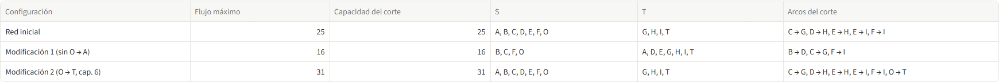
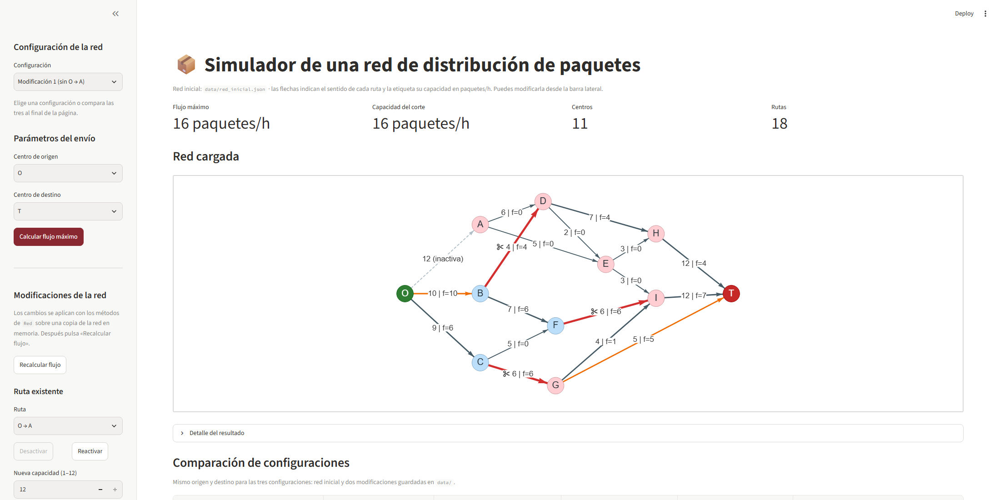
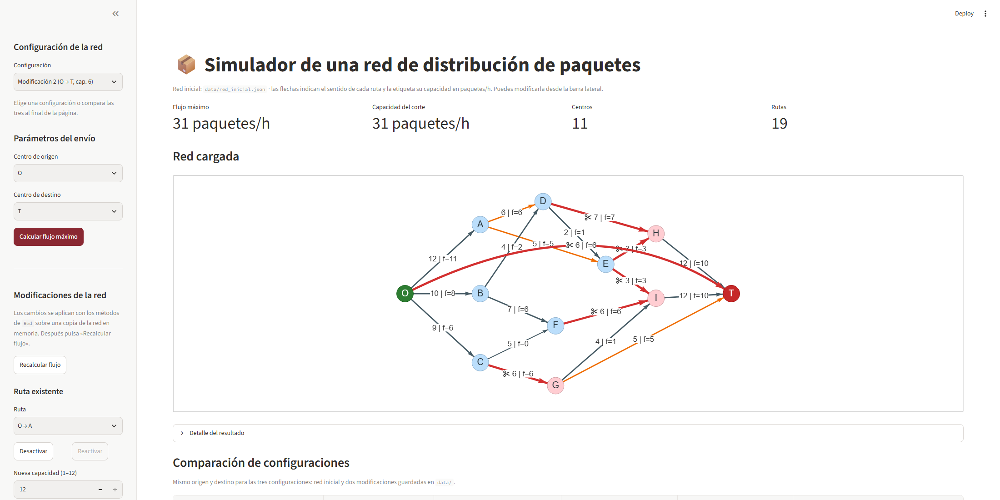

# 4. Simulación de las tres configuraciones

Las secciones anteriores describen una sola red y un solo resultado. En esta sección se simulan
tres configuraciones: la red inicial y dos modificaciones acordadas con el grupo. Las tres tienen
los mismos centros, los mismos extremos $s = O$ y $t = T$, y se resuelven con el mismo
procedimiento (sección 2). Al compararlas se ve cómo cambia el cuello de botella cuando se quita
una ruta o se agrega una nueva.

La aplicación permite elegir la configuración desde la barra lateral y mostrar las tres en una
tabla comparativa, de modo que los números del informe se pueden reproducir en la interfaz.

## 4.1 Configuraciones simuladas

| Configuración | Archivo | Cambio respecto de la red inicial |
|:---|:---|:---|
| Red inicial | `data/red_inicial.json` | Ninguno; 18 rutas activas. |
| Modificación 1 | `data/modificacion_1.json` | Se desactiva la ruta $(O,A)$, de capacidad 12. |
| Modificación 2 | `data/modificacion_2.json` | Se agrega la ruta $(O,T)$, de capacidad 6. |

Los dos archivos nuevos se generaron con los métodos de `src/red.py`: `desactivar_ruta("O", "A")`
y `agregar_conexion("O", "T", 6)`, seguidos de `guardar(...)`. Así se garantiza que conservan el
mismo formato y las mismas validaciones que la red inicial. Desactivar una ruta no la borra: la
deja con `activa = false`, de modo que su capacidad efectiva es 0 y el algoritmo no la considera
(sección 3.3).

En la interfaz, el selector **Configuración** recarga el archivo elegido, descarta cualquier
cambio local y borra el resultado anterior. El botón **Calcular flujo máximo** vuelve a ejecutar
Edmonds–Karp sobre esa configuración. La tabla **Comparación de configuraciones**, al final de la
página, calcula las tres filas con los mismos extremos elegidos.

## 4.2 Resultados

| Configuración | Flujo máximo $\lvert x\rvert$ | Capacidad del corte $c(S, V\setminus S)$ | $S$ | $V\setminus S$ | Arcos del corte |
|:---|:---:|:---:|:---|:---|:---|
| Red inicial | 25 | 25 | $\lbrace O, A, B, C, D, E, F\rbrace$ | $\lbrace G, H, I, T\rbrace$ | $(C,G)$, $(D,H)$, $(E,H)$, $(E,I)$, $(F,I)$ |
| Modificación 1 | 16 | 16 | $\lbrace O, B, C, F\rbrace$ | $\lbrace A, D, E, G, H, I, T\rbrace$ | $(B,D)$, $(C,G)$, $(F,I)$ |
| Modificación 2 | 31 | 31 | $\lbrace O, A, B, C, D, E, F\rbrace$ | $\lbrace G, H, I, T\rbrace$ | $(C,G)$, $(D,H)$, $(E,H)$, $(E,I)$, $(F,I)$, $(O,T)$ |

Como en la sección 3, se escribe $V\setminus S$ en lugar de $T$ para no confundir el conjunto con
el centro $T$; en la tabla de la interfaz esa columna aparece con el nombre `T`. La capacidad del
corte es la suma de las capacidades de los arcos de la última columna, y en los tres casos todos
esos arcos están saturados.

## 4.3 Red inicial: el cuello de botella de referencia

La red inicial transporta **25 paquetes por hora**. El corte mínimo coincide con el de la sección
3.4:

$$
S = \lbrace O, A, B, C, D, E, F\rbrace, \qquad V \setminus S = \lbrace G, H, I, T\rbrace,
$$

$$
c(S, V \setminus S) = 6 + 7 + 3 + 3 + 6 = 25.
$$

La restricción no está ni en la salida de $O$ (hasta 31 paquetes por hora) ni en la entrada a $T$
(hasta 29), sino en los cinco arcos que cruzan hacia $G$, $H$ e $I$. Por ejemplo, $(G,T)$ está
saturado con $5/5$, pero no pertenece al corte: $G$ ya quedó del lado del destino. Este resultado
sirve de referencia para medir el efecto de las dos modificaciones.

## 4.4 Modificación 1: sin la ruta $O \to A$

Al desactivar $(O,A)$ desaparecen 12 de capacidad de salida: desde $O$ solo quedan $(O,B)$, de 10,
y $(O,C)$, de 9. El flujo máximo baja de 25 a **16 paquetes por hora**, es decir 9 menos, no 12.
La razón es que en el flujo calculado para la red inicial $(O,A)$ transportaba 11 paquetes por
hora, no su capacidad completa, y parte de ese flujo se redirige por $(O,B)$, que pasa de 8 a 10.
Quitar una ruta no resta necesariamente su capacidad del flujo; el nuevo valor lo fija el nuevo corte mínimo.

La partición también cambia:

$$
S = \lbrace O, B, C, F\rbrace, \qquad V \setminus S = \lbrace A, D, E, G, H, I, T\rbrace.
$$

$A$ pasa al lado del destino porque su única entrada era $(O,A)$: al desactivarla ya no es
alcanzable desde $O$ en el grafo residual. $D$ y $E$ también quedan fuera de $S$: la única ruta
desde un centro de $S$ hacia $D$ es $(B,D)$, que está saturada, y las entradas a $E$ llegan desde
centros que ya no son alcanzables. El corte se recompone en tres arcos, todos saturados:

$$
c(S, V \setminus S) = c(B,D) + c(C,G) + c(F,I) = 4 + 6 + 6 = 16.
$$

$(O,B)$ también queda saturado con $10/10$, pero no está en el corte porque $B$ pertenece a $S$.
Este caso muestra que el corte mínimo **no es fijo**: depende de qué rutas siguen disponibles, y
que al eliminar una ruta puede aparecer un cuello de botella distinto del original.

## 4.5 Modificación 2: conexión directa $O \to T$

Aquí se agrega $(O,T)$ con capacidad 6, sin tocar las 18 rutas originales. El flujo máximo sube de
25 a **31 paquetes por hora**. El motivo es directo: $O$ está en $S$ y $T$ en
$V\setminus S$, así que el nuevo arco cruza exactamente la misma partición que el corte inicial.
Los cinco arcos anteriores siguen transportando lo mismo y el nuevo arco lleva $6/6$:

$$
c(S, V \setminus S) = 6 + 7 + 3 + 3 + 6 + 6 = 31,
\qquad
S = \lbrace O, A, B, C, D, E, F\rbrace.
$$

La partición no cambia porque las rutas originales se mantienen. El incremento es exactamente 6
porque esa es la capacidad del único arco nuevo que cruza el corte en sentido $S \to V\setminus S$.
Si la conexión se hubiera agregado entre dos centros del mismo lado, el flujo no habría cambiado
(sección 3.2). Con la modificación, desde $O$ podrían salir hasta 37 paquetes por hora y a $T$
podrían llegar hasta 35, pero el corte de 31 sigue siendo el límite que determina el resultado.

## 4.6 Comprobación del teorema en las tres configuraciones

| Configuración | $\lvert x\rvert$ | $c(S, V\setminus S)$ | Arcos del corte saturados |
|:---|:---:|:---:|:---:|
| Red inicial | 25 | 25 | 5 de 5 |
| Modificación 1 | 16 | 16 | 3 de 3 |
| Modificación 2 | 31 | 31 | 6 de 6 |

En las tres configuraciones se cumple $\max \lvert x\rvert = \min c(S, V\setminus S)$, como
asegura el teorema de la sección 3.2. `src/corte.py` comprueba esa igualdad antes de mostrar un
corte y lanza un error si el flujo recibido no fuera máximo. Los valores de esta tabla también
están fijados en `tests/test_configuraciones.py`, que verifica que los tres archivos JSON sean
válidos, que las modificaciones coincidan con los métodos de `Red` y que la interfaz permita
cambiar de configuración y recalcular.

En resumen: quitar $(O,A)$ reduce el flujo en 9 y cambia el cuello de botella; agregar $(O,T)$ lo
aumenta en 6 y deja la partición original. En ambos casos la variación se explica por lo que ocurre
en el corte mínimo y no por los límites de salida o entrada de la red.
