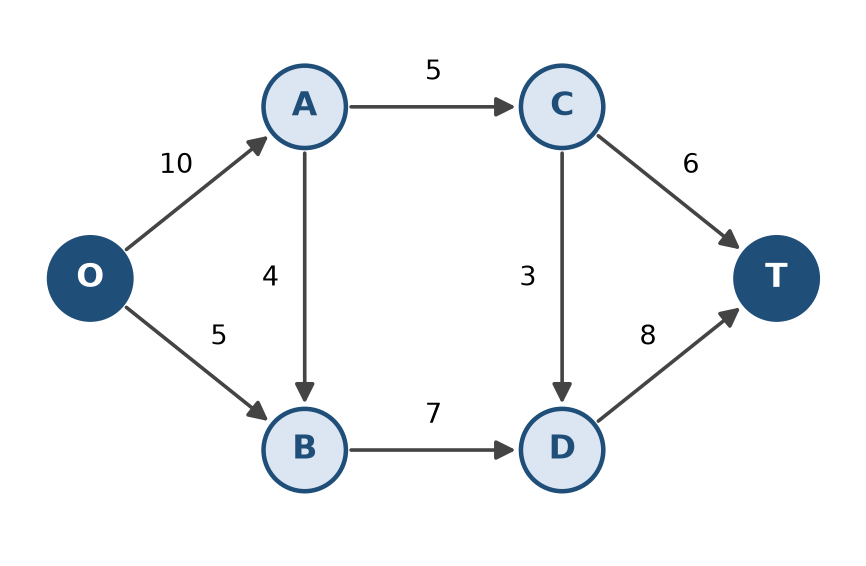
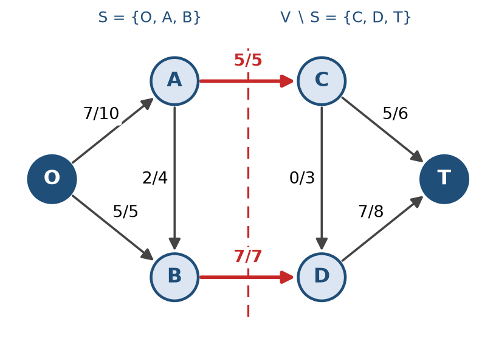
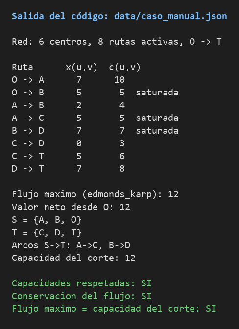
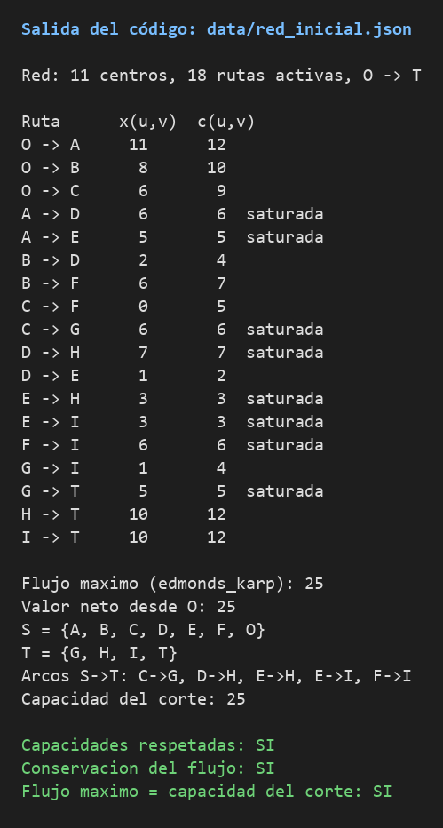
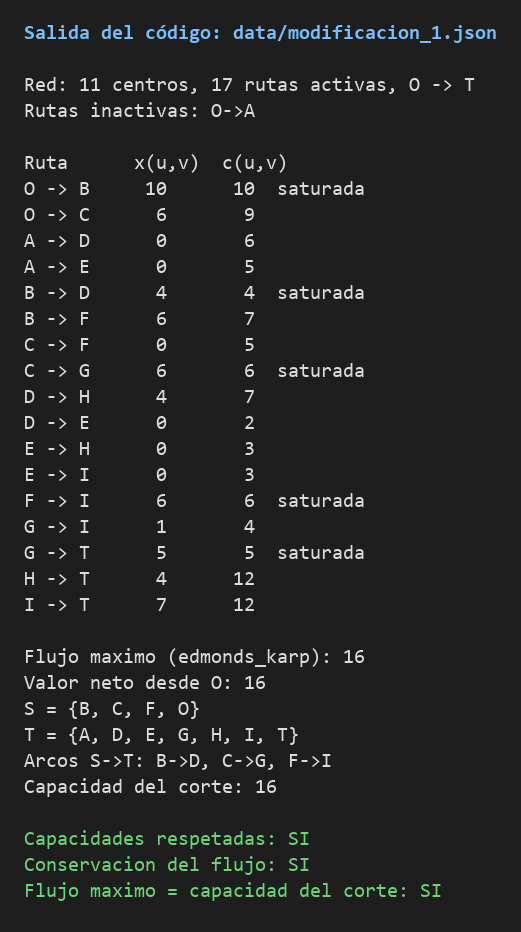
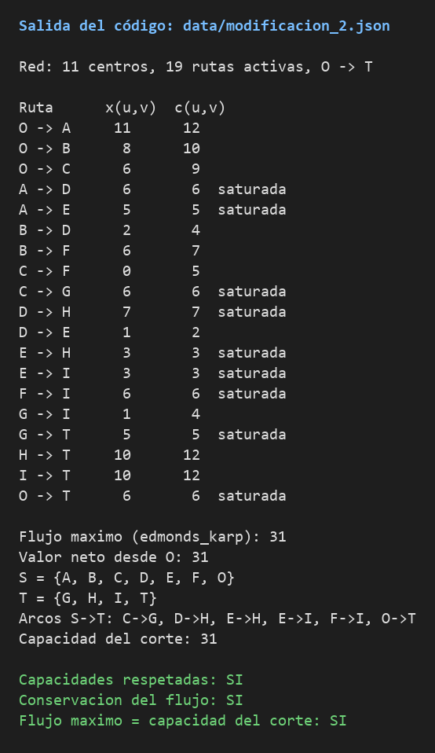

# 5. Verificación de resultados

Antes de confiar en lo que entrega el código sobre la red principal, conviene tener un caso en
el que la respuesta se pueda obtener y comprobar a mano. Para eso se construyó una red pequeña,
se resolvió con el mismo procedimiento que sigue el algoritmo (sección 2) y se justificó la
optimalidad del resultado con un flujo y un corte de igual valor.

## 5.1 Caso de comprobación

La red de comprobación está guardada en `data/caso_manual.json`. Tiene seis centros y ocho
rutas, todas con capacidad entera:

$$
V = \lbrace O,\ A,\ B,\ C,\ D,\ T\rbrace, \qquad |V| = 6, \qquad s = O, \quad t = T.
$$

$$
E = \lbrace\ (O,A),\ (O,B),\ (A,B),\ (A,C),\ (B,D),\ (C,D),\ (C,T),\ (D,T)\ \rbrace, \qquad |E| = 8.
$$

| Arco $(u, v)$ | $(O,A)$ | $(O,B)$ | $(A,B)$ | $(A,C)$ | $(B,D)$ | $(C,D)$ | $(C,T)$ | $(D,T)$ |
|:---|:---:|:---:|:---:|:---:|:---:|:---:|:---:|:---:|
| $c(u, v)$ | 10 | 5 | 4 | 5 | 7 | 3 | 6 | 8 |

La red cumple las mismas reglas que la red principal: no tiene lazos, arcos repetidos ni arcos
recíprocos, y ningún centro queda aislado. Entre $O$ y $T$ hay cuatro caminos dirigidos:

$$
O \to A \to C \to T, \qquad O \to B \to D \to T, \qquad
O \to A \to B \to D \to T, \qquad O \to A \to C \to D \to T.
$$

Se eligió esta red porque el resultado no se ve a simple vista. Desde $O$ salen $10 + 5 = 15$
paquetes por hora y a $T$ pueden llegar $6 + 8 = 14$, pero ninguno de esos dos valores es el
flujo máximo: la restricción está en el medio de la red.

## 5.2 Resolución manual con Edmonds–Karp

Se parte del flujo cero, de modo que la capacidad residual de cada arco es su capacidad y los
arcos de retroceso valen 0. En cada iteración se busca con BFS, desde $O$, el camino de aumento
con menos arcos. Solo se recorren arcos con capacidad residual positiva, y los vecinos se
visitan en el orden de la tabla anterior. Después se envía por ese camino $P_k$ su cuello de
botella $c_f(P_k)$.

**Iteración 1.** La BFS alcanza $A$ y $B$ en el primer nivel, luego $C$ (desde $A$) y $D$
(desde $B$), y finalmente $T$ desde $C$. El camino más corto es $O \to A \to C \to T$, con
residuales $10, 5, 6$:

$$
c_f(P_1) = \min\lbrace 10,\ 5,\ 6\rbrace = 5.
$$

Quedan $c_f(O,A) = 5$, $c_f(A,C) = 0$ y $c_f(C,T) = 1$, y aparecen los retrocesos
$c_f(A,O) = c_f(C,A) = c_f(T,C) = 5$.

**Iteración 2.** Como $(A,C)$ ya no tiene residual, la BFS llega a $T$ por
$O \to B \to D \to T$, con residuales $5, 7, 8$:

$$
c_f(P_2) = \min\lbrace 5,\ 7,\ 8\rbrace = 5.
$$

Quedan $c_f(O,B) = 0$, $c_f(B,D) = 2$ y $c_f(D,T) = 3$.

**Iteración 3.** Desde $O$ solo se puede avanzar a $A$. De ahí se pasa a $B$ por $(A,B)$, luego
a $D$ y a $T$. El camino es $O \to A \to B \to D \to T$, con residuales $5, 4, 2, 3$:

$$
c_f(P_3) = \min\lbrace 5,\ 4,\ 2,\ 3\rbrace = 2.
$$

Quedan $c_f(O,A) = 3$, $c_f(A,B) = 2$, $c_f(B,D) = 0$ y $c_f(D,T) = 1$.

**Iteración 4.** Desde $O$ se llega a $A$ y, por $(A,B)$, a $B$. No se puede seguir:
$c_f(A,C) = 0$, $c_f(B,D) = 0$, y los arcos de retroceso que salen de $A$ y de $B$ solo llevan a
centros ya visitados.
La BFS termina sin alcanzar $T$, así que no quedan caminos de aumento y el algoritmo se detiene.

| Iteración | Camino de aumento $P_k$ | Residuales del camino | $c_f(P_k)$ | Valor acumulado |
|:---:|:---|:---:|:---:|:---:|
| 1 | $O \to A \to C \to T$ | 10, 5, 6 | 5 | 5 |
| 2 | $O \to B \to D \to T$ | 5, 7, 8 | 5 | 10 |
| 3 | $O \to A \to B \to D \to T$ | 5, 4, 2, 3 | 2 | 12 |
| 4 | no existe | — | — | 12 |

En este caso no hizo falta usar arcos de retroceso: ningún camino encontrado por la BFS
devuelve flujo. Sumando lo enviado por cada camino se obtiene el flujo de cada ruta.

## 5.3 Flujo obtenido

| Arco $(u, v)$ | $(O,A)$ | $(O,B)$ | $(A,B)$ | $(A,C)$ | $(B,D)$ | $(C,D)$ | $(C,T)$ | $(D,T)$ |
|:---|:---:|:---:|:---:|:---:|:---:|:---:|:---:|:---:|
| Caminos que lo usan | 1, 3 | 2 | 3 | 1 | 2, 3 | — | 1 | 2, 3 |
| $x(u, v)$ | 7 | 5 | 2 | 5 | 7 | 0 | 5 | 7 |
| $c(u, v)$ | 10 | 5 | 4 | 5 | 7 | 3 | 6 | 8 |

**Capacidad.** En todos los arcos se cumple $0 \le x(u,v) \le c(u,v)$. Los arcos saturados
son $(O,B)$, $(A,C)$ y $(B,D)$.

**Conservación.** En cada vértice intermedio entra lo mismo que sale:

| Vértice | Entra | Sale |
|:---:|:---|:---|
| $A$ | $x(O,A) = 7$ | $x(A,B) + x(A,C) = 2 + 5 = 7$ |
| $B$ | $x(O,B) + x(A,B) = 5 + 2 = 7$ | $x(B,D) = 7$ |
| $C$ | $x(A,C) = 5$ | $x(C,D) + x(C,T) = 0 + 5 = 5$ |
| $D$ | $x(B,D) + x(C,D) = 7 + 0 = 7$ | $x(D,T) = 7$ |

**Valor.** Ningún arco entra a $O$, así que

$$
|x| = x(O,A) + x(O,B) = 7 + 5 = 12,
$$

que coincide con lo que llega a $T$: $x(C,T) + x(D,T) = 5 + 7 = 12$. El flujo $x$ es factible
y vale 12 paquetes por hora.

## 5.4 Corte asociado

En la última iteración la BFS alcanzó exactamente los centros $O$, $A$ y $B$. Ese conjunto
define el corte:

$$
S = \lbrace O,\ A,\ B\rbrace, \qquad V \setminus S = \lbrace C,\ D,\ T\rbrace.
$$

Se escribe $V \setminus S$ para no confundir el lado del destino con el vértice $T$. Los arcos
que van de $S$ hacia $V \setminus S$ son $(A,C)$ y $(B,D)$, y su capacidad es

$$
c(S, V \setminus S) = c(A,C) + c(B,D) = 5 + 7 = 12.
$$

Además, ningún arco va de $V \setminus S$ hacia $S$. Los dos arcos del corte están saturados.
Por eso el flujo neto que cruza el corte es exactamente su capacidad.

## 5.5 Optimalidad del flujo y del corte

Para cualquier flujo factible $y$ y cualquier corte $(S', V \setminus S')$ con $s \in S'$ y
$t \notin S'$, se suma la conservación sobre los vértices de $S'$. Lo que entra y sale entre
vértices de $S'$ se cancela, y queda (las sumas recorren los arcos $(u,v) \in E$):

$$
|y| = \sum_{u \in S',\ v \notin S'} y(u,v)
    \enspace - \enspace \sum_{u \notin S',\ v \in S'} y(u,v)
    \enspace \le \enspace \sum_{u \in S',\ v \notin S'} c(u,v) = c(S', V \setminus S').
$$

La desigualdad usa $y(u,v) \le c(u,v)$ en los arcos que salen de $S'$ y $y(u,v) \ge 0$ en los
que entran. De aquí salen las dos conclusiones:

- **El flujo es máximo.** Todo flujo factible cumple $|y| \le c(S, V \setminus S) = 12$, y $x$
  ya vale 12.
- **El corte es mínimo.** Todo corte cumple $c(S', V \setminus S') \ge |x| = 12$, y el corte
  encontrado vale 12.

Como el flujo y el corte tienen el mismo valor, cada uno certifica la optimalidad del otro. Es
el teorema de flujo máximo–corte mínimo aplicado a este caso.

En una red tan pequeña también se puede comprobar el corte de forma exhaustiva. $O$ siempre
está en $S'$ y $T$ nunca, así que hay $2^4 = 16$ cortes posibles, uno por cada subconjunto de
$\lbrace A, B, C, D\rbrace$:

| $S'$ | Arcos de $S'$ hacia $V \setminus S'$ | $c(S', V \setminus S')$ |
|:---|:---|:---:|
| $\lbrace O\rbrace$ | $(O,A), (O,B)$ | 15 |
| $\lbrace O, A\rbrace$ | $(O,B), (A,B), (A,C)$ | 14 |
| $\lbrace O, B\rbrace$ | $(O,A), (B,D)$ | 17 |
| $\lbrace O, C\rbrace$ | $(O,A), (O,B), (C,D), (C,T)$ | 24 |
| $\lbrace O, D\rbrace$ | $(O,A), (O,B), (D,T)$ | 23 |
| $\lbrace O, A, B\rbrace$ | $(A,C), (B,D)$ | **12** |
| $\lbrace O, A, C\rbrace$ | $(O,B), (A,B), (C,D), (C,T)$ | 18 |
| $\lbrace O, A, D\rbrace$ | $(O,B), (A,B), (A,C), (D,T)$ | 22 |
| $\lbrace O, B, C\rbrace$ | $(O,A), (B,D), (C,D), (C,T)$ | 26 |
| $\lbrace O, B, D\rbrace$ | $(O,A), (D,T)$ | 18 |
| $\lbrace O, C, D\rbrace$ | $(O,A), (O,B), (C,T), (D,T)$ | 29 |
| $\lbrace O, A, B, C\rbrace$ | $(B,D), (C,D), (C,T)$ | 16 |
| $\lbrace O, A, B, D\rbrace$ | $(A,C), (D,T)$ | 13 |
| $\lbrace O, A, C, D\rbrace$ | $(O,B), (A,B), (C,T), (D,T)$ | 23 |
| $\lbrace O, B, C, D\rbrace$ | $(O,A), (C,T), (D,T)$ | 24 |
| $\lbrace O, A, B, C, D\rbrace$ | $(C,T), (D,T)$ | 14 |

El menor valor es 12 y lo alcanza un solo corte, $S = \lbrace O, A, B\rbrace$: el mismo que encontró la
BFS. En esta red el corte mínimo es único.

**Interpretación.** Aunque el origen puede despachar 15 paquetes por hora y el destino recibir
14, por la red pasan como máximo 12. El límite lo ponen las rutas $A \to C$ y $B \to D$, que
conectan los centros cercanos al origen con los cercanos al destino. Aumentar la capacidad de
$O \to A$ o de las rutas que llegan a $T$ no cambiaría el resultado. Para transportar más habría
que ampliar alguna de esas dos rutas, o agregar otra que cruce el corte.

## 5.6 Contraste entre el cálculo manual y el código

Se ejecutó el código sobre la misma red de comprobación (`data/caso_manual.json`): primero
`edmonds_karp` para obtener el flujo máximo, después `corte_minimo` para el corte, y por último
las comprobaciones de `src/verificacion.py`. La Figura 5.3 muestra la salida.

Además, se registraron los caminos que encuentra la BFS del código en cada iteración, para
compararlos con los de la sección 5.2.

| Resultado | Cálculo manual | Código |
|:---|:---|:---|
| Iteración 1 | $O \to A \to C \to T$, aumento 5 | $O \to A \to C \to T$, aumento 5 |
| Iteración 2 | $O \to B \to D \to T$, aumento 5 | $O \to B \to D \to T$, aumento 5 |
| Iteración 3 | $O \to A \to B \to D \to T$, aumento 2 | $O \to A \to B \to D \to T$, aumento 2 |
| $x(O,A),\ x(O,B),\ x(A,B),\ x(A,C)$ | 7, 5, 2, 5 | 7, 5, 2, 5 |
| $x(B,D),\ x(C,D),\ x(C,T),\ x(D,T)$ | 7, 0, 5, 7 | 7, 0, 5, 7 |
| Flujo máximo | 12 | 12 |
| $S$ | $\lbrace O, A, B\rbrace$ | $\lbrace O, A, B\rbrace$ |
| $V \setminus S$ | $\lbrace C, D, T\rbrace$ | $\lbrace C, D, T\rbrace$ |
| Arcos del corte | $(A,C),\ (B,D)$ | $(A,C),\ (B,D)$ |
| Capacidad del corte | 12 | 12 |

No hay diferencias. Coinciden el valor, el flujo de cada ruta, el corte y también el orden de los
caminos. Esto último no estaba garantizado: cuando hay varios caminos con la misma cantidad de
arcos, la BFS elige según el orden en que recorre los vecinos. A mano se usó el orden de la tabla
de la sección 5.1, y el código recorre los vecinos en el orden en que las rutas aparecen en el
archivo, que es el mismo. Con otro orden podrían salir otros caminos y otro reparto del flujo entre
las rutas, pero el valor máximo seguiría siendo 12, porque el corte de capacidad 12 lo limita.

## 5.7 Verificación de las tres configuraciones

Se repitió la ejecución sobre la red principal y sus dos modificaciones, guardadas en `data/`, con
origen $O$ y destino $T$:

- **Red inicial** (`red_inicial.json`): la red de la sección 1.
- **Modificación 1** (`modificacion_1.json`): se desactiva la ruta $O \to A$.
- **Modificación 2** (`modificacion_2.json`): se agrega la ruta directa $O \to T$ con capacidad 6.

En cada caso se comprobaron las tres condiciones: que $0 \le x(u,v) \le c(u,v)$ en todas las
rutas (con `verificar_capacidades`), que en cada centro distinto de $O$ y $T$ entre lo mismo que
sale (con `verificar_conservacion`) y que el flujo máximo sea igual a la capacidad del corte.

| Configuración | Flujo máximo | $S$ | Arcos del corte | Capacidad del corte | Capacidades | Conservación |
|:---|:---:|:---|:---|:---:|:---:|:---:|
| Red inicial | 25 | $\lbrace O, A, B, C, D, E, F\rbrace$ | $(C,G), (D,H), (E,H), (E,I), (F,I)$ | 25 | Sí | Sí |
| Modificación 1 | 16 | $\lbrace O, B, C, F\rbrace$ | $(B,D), (C,G), (F,I)$ | 16 | Sí | Sí |
| Modificación 2 | 31 | $\lbrace O, A, B, C, D, E, F\rbrace$ | $(C,G), (D,H), (E,H), (E,I), (F,I), (O,T)$ | 31 | Sí | Sí |

Las tres configuraciones cumplen las tres condiciones, así que en todas el flujo entregado es
factible y máximo.

Los resultados también son coherentes con el teorema de la sección 3:

- **Modificación 1.** Al desactivar $O \to A$, el origen solo puede despachar por $O \to B$ y
  $O \to C$. El flujo baja de 25 a 16 y el corte cambia: ahora queda en $S = \lbrace O, B, C, F\rbrace$, y
  el centro $A$ pasa al lado del destino porque ya no se puede alcanzar desde $O$. La ruta
  $O \to B$ queda saturada (10 de 10).
- **Modificación 2.** La ruta nueva $O \to T$ cruza directamente el corte de la red inicial, que es
  el único mínimo. Por eso el corte mantiene los mismos conjuntos, suma ese arco y su capacidad
  pasa de 25 a $25 + 6 = 31$. El flujo máximo sube exactamente en 6: el resto de la red reparte el
  mismo flujo que en la red inicial, y la ruta nueva lleva 6 paquetes por hora (saturada).
